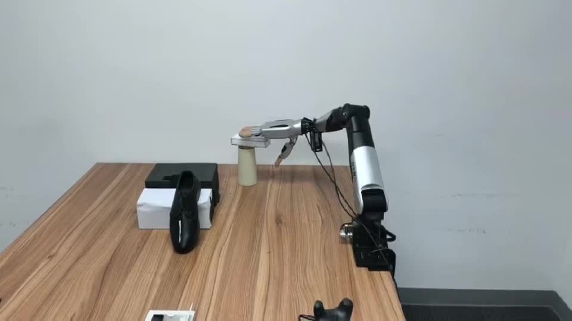
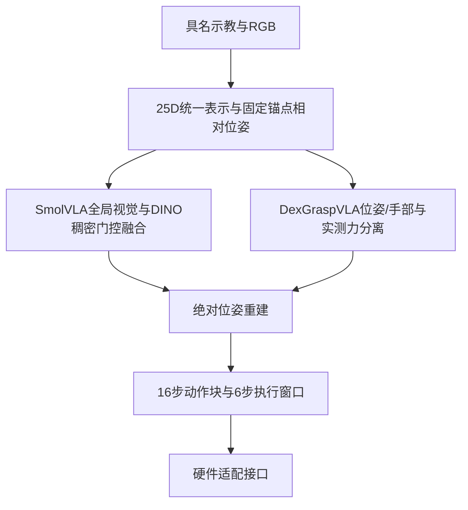

# Dexterous VLA Adaptation

**单臂灵巧操作策略适配：固定锚点相对位姿、DINO稠密视觉融合与位姿–力联合预测。**

[实机展示](https://yued2013-hash.github.io/dexterous-vla-adaptation/) · [技术说明](docs/method.md) · [实验记录](docs/evidence.md) · [训练工程](docs/training.md) · [代码来源](docs/provenance.md)



## 项目工作

基于 [LeRobot/SmolVLA](https://github.com/huggingface/lerobot) 和 [DexGraspVLA](https://github.com/Psi-Robot/DexGraspVLA)，完成单臂灵巧操作的数据表示、训练接口和模型模块适配，围绕工作区视觉细节与五指接触信息扩展动作预测流程。

- **统一数据与动作接口：** 将末端位姿和手部关节整理为25D控制表示，区分机器人反馈状态与遥操作指令，处理RGB时间对齐。
- **固定锚点相对位姿：** 同一动作块共享当前观测锚点，训练预测相对平移与旋转，推理重建绝对位姿；手部采用16D canonical通道。
- **稠密视觉融合：** 引入冻结DINOv2 ViT-B/14工作区特征，将1369个patch token投影到动作专家维度，通过8头门控交叉注意力融合。
- **位姿–力预测：** 分别编码25D位姿/手部控制与5D实测力，在30D预测接口中保留控制量与接触反馈的语义。
- **训练工程：** 实现分组损失、DDP有效元素计数归约、分阶段微调配置，以及动作块内视觉特征和K/V缓存复用。

## 实现模块

| 模块 | 实现要点 | 代码入口 |
| :-- | :-- | :-- |
| 动作表示 | xyz3 + rotation6D6 + canonical hand16；具名字段映射与单位约定 | [contracts.py](reference/contracts.py) |
| 相对位姿 | 动作块内固定观测锚点；平移差与旋转差；推理重建 | [relative_pose.py](integrations/smolvla/modules/relative_pose.py) |
| 分组损失 | xyz/rotation6D/hand分组；按有效标量计数进行DDP归约 | [training_math.py](reference/training_math.py) · [集成补丁](integrations/smolvla/patches/) |
| DINO视觉 | 37×37 patch网格，768→720投影，8头交叉注意力 | [dense_vision.py](integrations/smolvla/modules/dense_vision.py) |
| 零门控初始化 | 零初始化残差gate，衔接基础策略与视觉扩展 | [模型集成](integrations/smolvla/patches/) |
| 推理缓存 | DINO特征与K/V在10步流匹配去噪间复用 | [dense_vision.py](integrations/smolvla/modules/dense_vision.py) |
| 位姿–力分支 | 25D控制与5D实测力独立编码/归一化，合并预测 | [方法说明](docs/method.md) |

## 数据、训练与验证记录

| 项目 | 记录 |
| :-- | :-- |
| selected66数据 | **66段、23,283帧、10Hz**，采用全量66段训练配置 |
| 动作块与执行 | 预测16步，执行6步后重规划 |
| DINO阶段1 | **18,200步checkpoint记录**，3,155,760个可训练适配参数 |
| 模型检查 | 审计记录32项测试通过，真实forward/backward数值有限 |
| 零门控一致性 | 固定样本与噪声下，输出形状1×16×25，基础策略与扩展策略最大差0.0 |
| 数据来源检查 | feedback/command来源分离，数值回映差约3.58e-7 |
| RGB时间对齐 | 历史审计P95约16.17ms |
| 分布式退出排查 | 330步运行跨过325步epoch边界，End of training后不足5秒退出 |

训练阶段和参数设置见 [训练工程记录](docs/training.md)，逐项检查见 [实验记录](docs/evidence.md)。

## 数据与推理流程



实机视频展示机械臂与灵巧手的桌面物体操作：[观看视频](docs/media/demo.mp4)。

## 接口核验

```bash
git clone https://github.com/yued2013-hash/dexterous-vla-adaptation.git
cd dexterous-vla-adaptation
python -m pip install -r requirements-reference.txt
python -m unittest discover -s tests -v
python scripts/verify_evidence.py
```

参考测试覆盖表示转换、固定锚点、旋转约定、DDP计数及位姿/力接口。模型审计、配置与来源哈希保存在 [evidence](evidence/)，环境配置与本地资源路径通过 [configs](configs/) 管理。

## 代码与版本

- [reference](reference/)：NumPy/SciPy接口与训练数学参考。
- [integrations/smolvla/modules](integrations/smolvla/modules/)：相对位姿与DINO视觉融合模块。
- [integrations/smolvla/patches](integrations/smolvla/patches/)：针对固定LeRobot快照的模型、配置和训练入口补丁。
- [evidence](evidence/)：审计记录、文件SHA与补丁重建结果。
- [provenance](docs/provenance.md) · [THIRD_PARTY_NOTICES](THIRD_PARTY_NOTICES.md)：社区基础框架、版本与授权说明。
