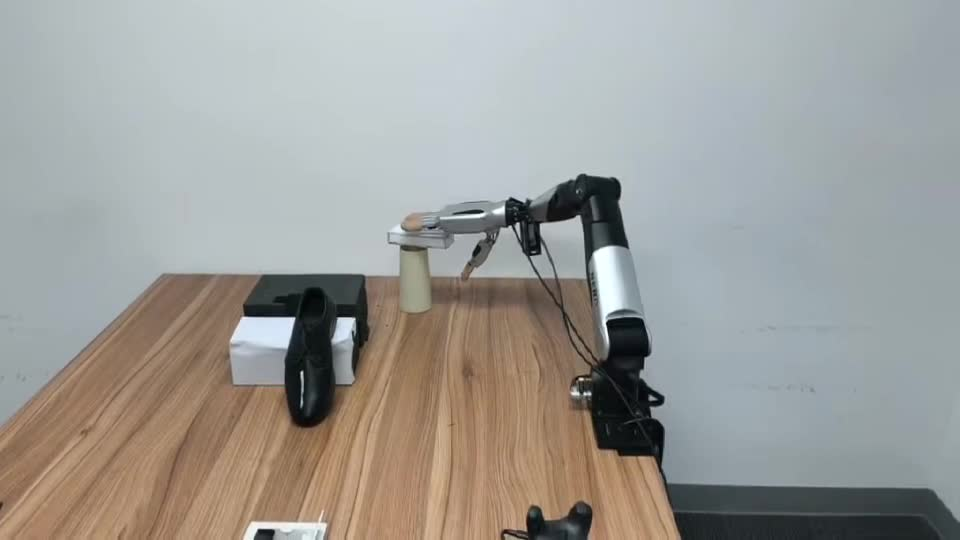
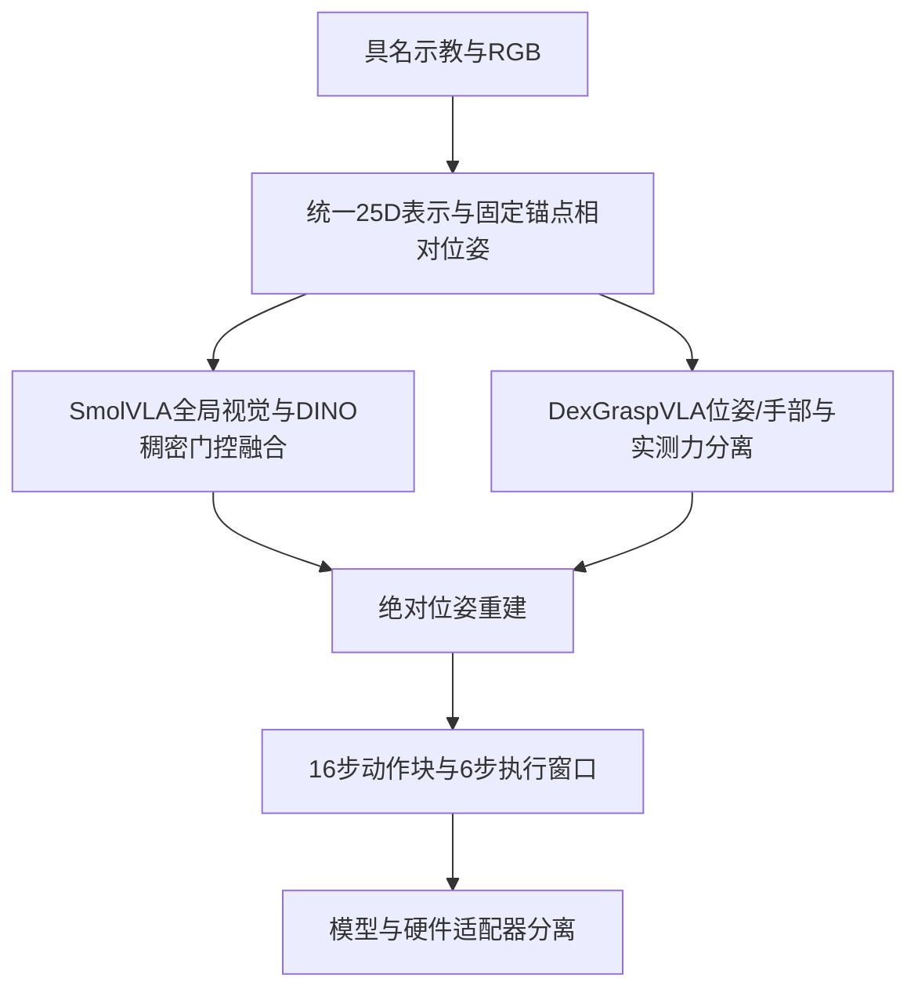

# Dexterous VLA Adaptation

**单臂灵巧操作的策略适配：统一位姿/手部表示、SmolVLA稠密视觉融合与位姿–力分支。**

[项目展示](https://yued2013-hash.github.io/dexterous-vla-adaptation/) · [技术说明](docs/method.md) · [证据与验证范围](docs/evidence.md) · [代码来源](docs/provenance.md) · [实机演示](docs/media/demo.mp4)



## 项目范围

基于社区的 [LeRobot/SmolVLA](https://github.com/huggingface/lerobot) 与 [DexGraspVLA](https://github.com/Psi-Robot/DexGraspVLA) 开展单臂灵巧操作适配。两个代码包与实机视频属于同一个项目的不同材料，这里统一整理数据/动作接口、视觉扩展、训练实现和已有审计记录。

本仓库包含可审查的SmolVLA模块改动、基于NumPy/SciPy的独立接口参考、回归测试、经路径脱敏的审计文件和训练配置。它不是重新发布完整基础框架，也不将社区模型、既有接口实现或上游论文结果视为原创成果。

## 实现内容

| 模块 | 实际实现 |
| :-- | :-- |
| 数据语义 | 区分robot feedback状态与teleoperation command动作，记录来源与RGB时间对齐 |
| 统一表示 | 模型控制25D=xyz3+rotation6D6+canonical hand16；原始紧凑25D中的validity/quaternion布局并不等价 |
| 相对位姿 | 整个动作块共享当前观测锚点，world-frame平移差与旋转差；推理重建绝对位姿，手部保持绝对值 |
| 分组损失 | xyz/rotation6D/hand分组及按有效元素计数的DDP归约；具体权重取自各配置 |
| DINO稠密视觉 | 冻结ViT-B/14，37×37=1369个patch token，768→720投影，8头门控交叉注意力融合至动作专家 |
| 零门控热启动 | 零初始化残差gate保持基础策略初始输出不变；历史固定噪声审计最大差0.0 |
| 推理缓存 | DINO特征与K/V在动作块内复用；减少10步去噪中的重复投影，不据此声称整体推理加速比 |
| 位姿–力版本 | 25D控制与5D实测力使用独立编码/归一化，公开边界合为30D；力输出是未来实测反馈预测，不是力控命令 |

## 数据与模型路径



## 记录规模

- 所选数据分支的审计记录：**66段、23,283帧、10Hz**，动作块16步、在线执行6步后重规划。
- 该分支使用全部66段训练，没有独立验证/测试划分，不能用训练数据或内部检查声称泛化成功率。
- DINO分支历史审计记录32项测试通过、真实forward/backward有限、零门控等价；阶段1 checkpoint记录为18,200步。
- 阶段2/位姿–力400epoch配置存在，但本材料包未包含对应完整训练日志或最终权重，不宣称这些训练均已完成。
- 未提供实机总试验数、模型对照与成功率记录；视频仅作实机演示，具体模型/检查点关联未知。

## 可运行的接口核验

```bash
git clone https://github.com/yued2013-hash/dexterous-vla-adaptation.git
cd dexterous-vla-adaptation
python -m pip install -r requirements-reference.txt
python -m unittest discover -s tests -v
python scripts/verify_evidence.py
```

这些命令只检查表示、数学约定与保存的审计记录，不启动GPU训练、下载基础模型或发送机器人指令。当前测试与历史32项模型测试分开记录。

## 代码导航

- [reference/contracts.py](reference/contracts.py)：独立参考实现，演示固定锚点变换、表示转换及位姿/力边界。
- [reference/training_math.py](reference/training_math.py)：DDP有效计数归约与流匹配数学参考。
- [integrations/smolvla/modules](integrations/smolvla/modules)：材料中的`relative_pose.py`和`dense_vision.py`，保留原版权头及Apache-2.0授权文件。
- [integrations/smolvla/patches](integrations/smolvla/patches)：相对提供的`lerobot-source`快照生成的模型、配置、训练与数据入口差异，不应盲目应用于任意最新版LeRobot。
- [evidence](evidence/)：原始审计数值、来源哈希、源码变更清单与证据状态。
- [configs](configs/)：路径脱敏的SmolVLA配置快照；`${LOCAL_ARTIFACTS}`为待配置路径，不是直接可运行环境。

## 实机与模型边界

提供的视频约26秒，展示机械臂与灵巧手操作桌面物体。未建立视频与某一训练分支/检查点的可靠对应关系，不能据此判断DINO或力分支优于基础策略。

DexGraspVLA适配分支为planner-free的低层视觉动作策略，不包含原论文中的VLM规划、SAM或Cutie。硬件接口仍有待接入的实现点，不能把这些代码包描述为开箱即用的完整实机系统。视频不替代多次、可追踪的闭环评估。

## 来源

来源、固定版本标记、代码快照SHA与分发范围见 [provenance](docs/provenance.md) 和 [THIRD_PARTY_NOTICES.md](THIRD_PARTY_NOTICES.md)。原始示教数据、基础模型权重、机器人SDK、设备地址和训练机器路径均不打包。
